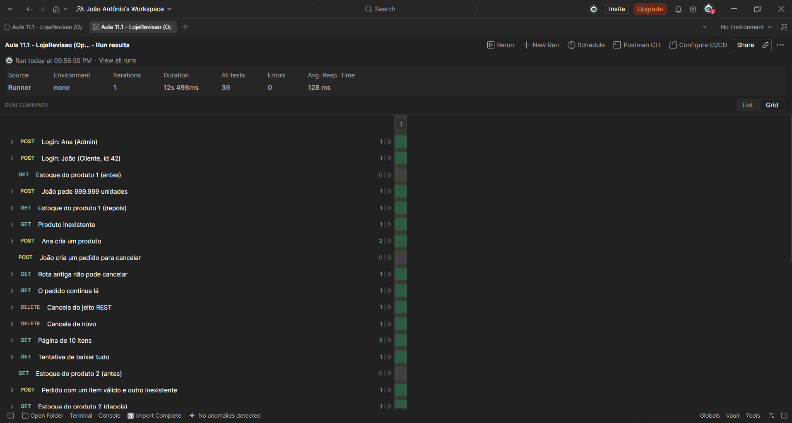
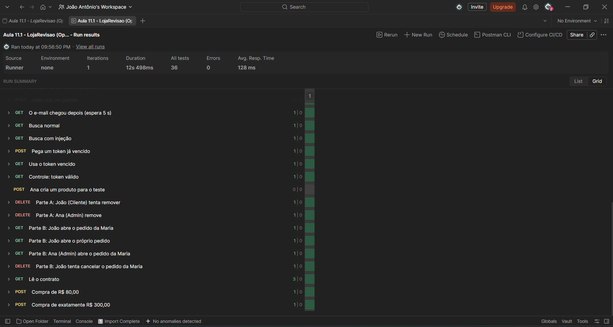
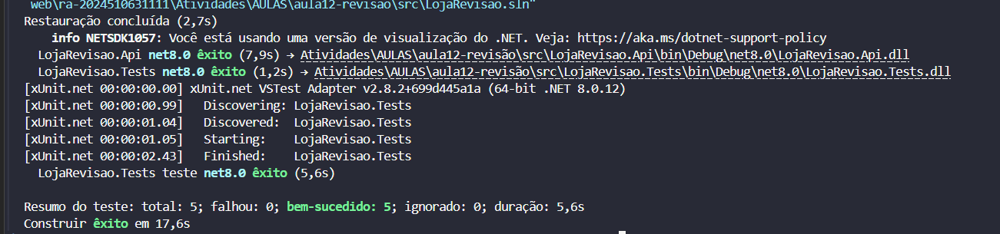

# HANDOUT - AULA 11.1 / AULA 12
## O Prontuário da LojaRevisao
**Revisão das Aulas 01 a 11 — Arquitetura de Aplicações Web**

**Aluno:** João Antônio  
**Turma:** Engenharia de Software / Arquitetura de Aplicações Web  
**Data:** 07/11/2026  

---

## 📸 Comprovações e Entregáveis (Prints)

### 1. Suíte de Testes Postman Runner (34 de 34 testes aprovados)

### 2. Testes Automatizados Unitários (`dotnet test` — 5 aprovados)

---

## PARTE 01 — Diário de Correção (durante a prática)

| Falha | Aula | A regra que estava sendo violada, em uma frase | Verde? |
|---|---|---|:---:|
| **01** | 01 | O módulo de Pedidos alterava diretamente o banco do Catálogo ignorando regras de domínio e fronteiras de contexto; deve-se usar `ICatalogo.Reservar`. | ✅ |
| **02** | 02 | Retornava status code 200 HTTP com payload de erro e 200 no POST; criação exige `201 Created` com header `Location`, e item inexistente exige `404 NotFound`. | ✅ |
| **03** | 03 | Ação destrutiva configurada como `GET /api/v1/cancelarPedido?id=N` com verbo na URI; ações devem usar o método HTTP correto (`DELETE /api/v1/pedidos/{id}`) e responder `204 NoContent`. | ✅ |
| **04** | 04 | A listagem retornava a tabela inteira (2.000 itens) sobrecarregando rede e memória; paginação no servidor com `page`, `size`, `Skip` e `Take` encapsulados em `Pagina<T>` é mandatória. | ✅ |
| **05** | 05 | O método chamava `_db.SaveChanges()` dentro do loop de itens violando a atomicidade (ACID); a persistência deve ser atômica ao final da transação. | ✅ |
| **06** | 06 | O processamento da requisição ficava travado de forma síncrona aguardando serviço externo de e-mail (>3s); comunicação não-crítica deve ser desacoplada via mensageria assíncrona (`FilaDeNotificacoes`). | ✅ |
| **07** | 07 | Concatenação direta de strings em comandos SQL gerando vulnerabilidade crítica de SQL Injection; consultas devem ser parametrizadas com `EF.Functions.Like` ou parâmetros posicionais `{0}`. | ✅ |
| **08** | 08 | Validação de expiração de token JWT estava desativada (`ValidateLifetime = false`), permitindo acesso vitalício com tokens expirados. | ✅ |
| **09** | 09 | Falta de controle de acesso baseado em papéis (RBAC) na deleção de produtos e falta de controle baseado em atributos/posse (ABAC) na consulta e cancelamento de pedidos de terceiros (BOLA/IDOR). | ✅ |
| **10** | 10 | A documentação Swagger/OpenAPI mentia status codes de sucesso (anunciava 200 em vez de 201), omitia códigos de erro e não definia o esquema de autenticação Bearer JWT. | ✅ |
| **11** | 11 | A regra de negócio estipulava frete grátis a partir de R$ 300,00 (`>= 300`), mas o código usava `> 300` e a suíte de testes xUnit não cobria o valor de borda exato de R$ 300,00. | ✅ Postman ✅ dotnet test |

---

## PARTE 02 — Sintoma, Aula e Conceito (em casa)

| # | Sintoma relatado | Aula | Conceito violado |
|---|---|:---:|---|
| **A** | Cada compra demora mais de 3 segundos. O log mostra o sistema esperando o provedor de e-mail responder. | **Aula 06** | **Comunicação Assíncrona e Desacoplamento:** Operações não-críticas e lentas (I/O externo) devem ser delegadas para filas/background workers em vez de bloquear o ciclo de request/response HTTP. |
| **B** | O app abre uma tela vazia: para um produto que não existe, a API responde 200 com `{"erro": "..."}` no corpo. | **Aula 02** | **Semântica dos Status Codes HTTP (REST Fundamentos):** Erros de recurso inexistente devem retornar status `404 Not Found` no protocolo HTTP, e não mascarados com `200 OK`. |
| **C** | João abriu o pedido da Maria trocando o número na URL. E um Cliente conseguiu apagar produtos do catálogo. | **Aula 09** | **Controle de Acesso (RBAC e ABAC):** Falta de RBAC (Role-Based Access Control) para restringir deleção a Administradores e falta de ABAC (Attribute-Based Access Control) para validar a posse do recurso (IDOR/BOLA). |
| **D** | A tela de produtos mostra 10 itens, mas baixa 2.000 registros a cada abertura. | **Aula 04** | **Paginação no Servidor:** Listagens devem paginar dados no banco de dados (`LIMIT/OFFSET` ou `Skip/Take`) para preservar recursos do servidor, rede e latência. |
| **E** | Quem compra exatamente R$ 300,00 paga frete, embora a regra diga "grátis a partir de R$ 300,00". Os testes estão todos verdes. | **Aula 11** | **Testes Automatizados e Análise de Valores-Limite (Bordas):** A suíte de testes não exercitou o valor limítrofe (`300.00`), criando uma falsa sensação de segurança com testes incompletos. |
| **F** | Um pedido de 999.999 unidades foi aceito e o estoque ficou negativo. A regra existe no Catálogo, mas os Pedidos alteram a tabela dele diretamente. | **Aula 01** | **Fronteira entre Módulos e Baixo Acoplamento:** Violação dos limites de domínio (Bounded Contexts) num monólito; um módulo acessou as tabelas internas de outro sem passar pela sua interface de negócio (`ICatalogo`). |
| **G** | Um token vencido há 5 minutos continua abrindo a API. | **Aula 08** | **Autenticação Stateless com JWT e Validação de Vida Útil:** Configuração incorreta dos parâmetros de token (`ValidateLifetime = false`), permitindo ataques de repetição e uso de credenciais já expiradas. |
| **H** | O robô de um buscador passou pelo site e vários pedidos foram cancelados. A rota: `GET /api/v1/cancelarPedido?id=7`. | **Aula 03** | **Segurança e Idempotência dos Verbos HTTP (REST API Design):** Requisições `GET` devem ser seguras e somente-leitura; mutações de estado exigem métodos específicos como `DELETE` ou `POST`. |
| **I** | Um pedido com um item válido e outro inexistente devolve erro, mas o estoque do item válido baixou. | **Aula 05** | **Atomicidade e Transações (ACID):** Persistências parciais intermediárias quebraram a atomicidade; em caso de falha de qualquer item, todas as alterações devem sofrer rollback conjunto. |
| **J** | O time parceiro reclama: o Swagger diz que o POST devolve 200, ele devolve 201, e não há onde informar o token. | **Aula 10** | **Contrato de API e OpenAPI/Swagger:** A especificação deve ser fiel à implementação real, descrevendo os status codes corretos (`[ProducesResponseType]`) e esquemas de segurança (Bearer Auth). |
| **K** | Alguém digitou `%' OR '1'='1` na busca, e a loja listou o catálogo inteiro. | **Aula 07** | **Segurança contra Injeção de SQL (OWASP Top 10):** Concatenação bruta de input de usuário na cláusula SQL; deve-se usar consultas parametrizadas ou abstração por ORM. |

---

## PARTE 03 — Perguntas que Cruzam Aulas (em casa)

### 1. Sintoma I: se o Catálogo fosse outro serviço, com banco próprio, a correção continuaria simples? Por quê?
**Resposta:**  
Não, seria significativamente mais complexa. No monólito atual com um único banco de dados, a atomicidade é garantida nativamente pelo Entity Framework Core em uma única transação de banco de dados (`_db.SaveChanges()`), desfazendo qualquer mudança pendente em caso de falha.  
Se o Catálogo fosse um microsserviço independente com seu próprio banco de dados (*Database-per-Service*, Aula 01 e Aula 05), não existiria uma transação ACID relacional unificada entre os dois serviços. Seria necessário implementar padrões distribuídos de consistência eventual, como o **Padrão Saga** (orquestrada ou coreografada) com transações compensatórias (por exemplo, um evento de estorno para repor o estoque reservado caso a criação do pedido falhe) ou protocolos de *Two-Phase Commit* (2PC), que adicionam grande complexidade e latência.

---

### 2. O sintoma C esconde duas falhas. Uma se resolve com papel; a outra, não. Qual é qual, e por quê?
**Resposta:**  
- **A falha resolvida por Papel (RBAC):** Um cliente conseguir remover produtos do catálogo.  
  - *Por quê:* Esta permissão é coarse-grained (de granularidade grossa) baseada unicamente no perfil/cargo do usuário. A regra diz: "Apenas usuários com o papel `Admin` podem executar exclusões no catálogo". Isso é resolvido de forma estática com anotações de papéis (`[Authorize(Roles = "Admin")]`).
- **A falha NÃO resolvida por Papel (ABAC / Objeto / Propriedade):** João abrir o pedido da Maria trocando o ID na rota (`IDOR / BOLA`).  
  - *Por quê:* Ambos os usuários (João e Maria) possuem o mesmo papel no sistema (`Cliente`). O papel por si só não impede o João de acessar pedidos alheios, pois clientes *têm* permissão para ver pedidos. A validação precisa avaliar dinamicamente os **atributos do recurso** em tempo de execução: o `UsuarioId` gravado naquele pedido específico corresponde ao ID do usuário autenticado no token JWT (`UsuarioLogadoId`), ou o usuário é um Administrador? Isso exige **ABAC (Attribute-Based Access Control)** ou verificação de posse do recurso.

---

### 3. Sintoma E: como uma suíte pode estar toda verde com um bug no código? Que cuidado foi esquecido?
**Resposta:**  
Uma suíte de testes pode ficar 100% verde mesmo contendo bugs porque os testes apenas validam os cenários, asserções e dados específicos que o desenvolvedor escreveu. Se o teste validar apenas valores distantes da borda (por exemplo, testando R$ 200,00 e R$ 400,00), o comportamento no limiar crítico nunca é executado nem verificado.  
**Cuidado esquecido:** A técnica de **Análise de Valores-Limite (Boundary Value Analysis - BVA)** e Particionamento por Equivalência (Aula 11). Quando uma regra diz "grátis *a partir de* R$ 300,00", é obrigatório testar especificamente os três pontos da fronteira:
1. Logo abaixo da borda: `R$ 299,99` (deve pagar frete).
2. **Na borda exata:** `R$ 300,00` (deve ter frete grátis: R$ 0,00).
3. Logo acima da borda: `R$ 300,01` (deve ter frete grátis: R$ 0,00).  
Além disso, um dos testes no código original calculava o valor mas omitia a verificação (`Assert`), tornando o teste uma verificação inútil (falso positivo).

---

## 🏆 DESAFIO

### Se a sexta-feira chegasse e só desse tempo de corrigir 3 das 11 falhas, quais seriam? Justifiquem pelo dano em produção.

Se tivéssemos que priorizar estritamente pelo **potencial de dano financeiro, invasão e perda catastrófica de dados** em produção:

1. **FALHA 07 — Injeção de SQL (`Controllers/ProdutosController.cs`):**  
   - **Justificativa de dano:** É uma vulnerabilidade crítica da OWASP (Top 10). Permite que atacantes externos executem queries arbitrárias, façam dump de todo o banco de dados (dados cadastrais, e-mails, pedidos), alterem preços, apaguem tabelas inteiras (`DROP TABLE`) ou assumam o controle do servidor de banco de dados. Em produção, isso acarreta vazamento de dados gravíssimo (LGPD) e colapso operacional da empresa.
2. **FALHA 03 — Verbo na URI e GET com Efeito Colateral (`Controllers/PedidosController.cs`):**  
   - **Justificativa de dano:** Viola a idempotência e segurança do protocolo HTTP. Como a rota de cancelamento respondia a requisições `GET`, qualquer web crawler de indexadores de busca (como o Googlebot), ferramentas de prefetching de navegadores, ou usuários clicando em links cancelariam indiscriminadamente os pedidos dos clientes sem qualquer ação intencional. Isso geraria cancelamento massivo de vendas legítimas e prejuízo financeiro imediato à loja na data de lançamento.
3. **FALHA 01 — Fronteira entre Módulos / Venda sem Validação de Estoque (`PedidoService.cs`):**  
   - **Justificativa de dano:** Permitir que pedidos com qualquer volume (ex: 999.999 unidades) sejam concluídos e deixem o estoque negativo destrói a integridade do negócio. Vender itens inexistentes gera *overselling* (venda a descoberto), impossibilidade de entrega física, multas contratuais, chargebacks em massa, estornos no gateway de pagamento e severo dano reputacional à marca na primeira semana de operação.
